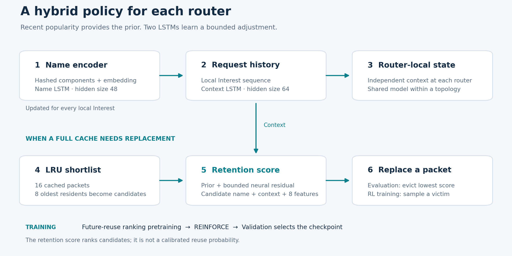
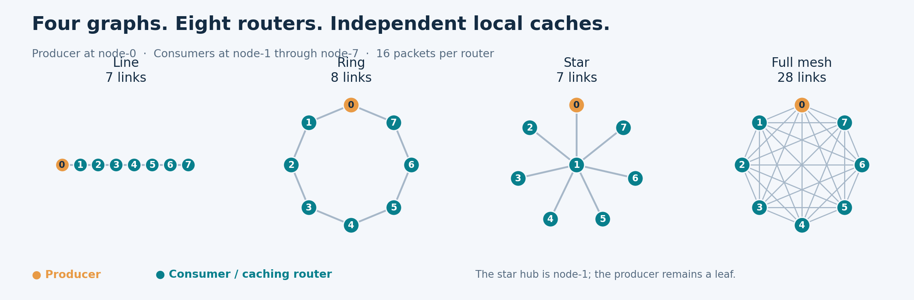
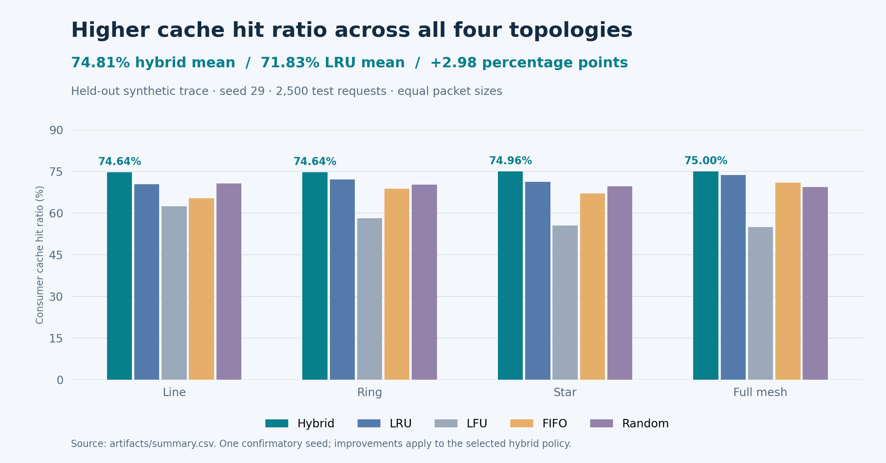

<div align="center">

# Hybrid Neural Cache Replacement for NDN

**Learning what to keep in the network.**

A hybrid cache replacement policy combining recent popularity, two LSTMs, and policy-gradient learning for Named Data Networking.


[](https://github.com/Amink8203/Hybrid_Neural_Cache_Replacement_for_NDN/actions/workflows/checks.yml)

[Quick start](#quick-start) · [Results](#results) · [Experiment details](docs/EXPERIMENTS.md) · [Report](report/report.pdf) · [Presentation](presentation/Hybrid_Neural_Cache_Replacement_for_NDN.pptx)

</div>

## Overview

In Named Data Networking (NDN), consumers request content by name. A router can satisfy an Interest from its **Content Store**, saving a trip to the producer. The challenge is deciding which Data packet to evict when that store is full, especially as content popularity changes.

This project implements a Python simulator and a hybrid retention policy. A causal, exponentially decayed popularity prior provides a starting point; a neural residual uses content names, router-local request history, and cache features to refine the ranking. Each network topology has its own model, with shared weights and independent state across its routers.

The included confirmatory experiment achieves **74.81% mean cache hit ratio**, compared with **71.83% for LRU**: an improvement of **2.98 percentage points** across four topologies. These are results from one held-out synthetic trace, with seed 29.

## How it works



1. **Encode names and local history.** Stable component hashing and an embedding feed a name LSTM; a second LSTM tracks the Interest sequence observed at each router.
2. **Shortlist eviction candidates.** When replacement is necessary, select the **8 least recently accessed residents** from a cache of 16 packets.
3. **Score retention value.** Combine each candidate's name, request context, and eight numeric features with the popularity prior. Evict the lowest-scoring resident during evaluation; sample eviction actions during RL training.
4. **Learn in two stages.** Pretrain with pairwise future-reuse ranking on training-only router observations, then fine-tune using REINFORCE and future local cache-hit rewards. Select the checkpoint using validation hit ratio.

The numeric features capture decayed frequency, recency, regularity, cache-hit fraction, residency recency, freshness remaining, relative size, and whether a candidate is incoming. The score is a **retention ranking**, not a calibrated probability of reuse.

Candidate scoring runs only when replacement is required. The request-context LSTM still advances on every local Interest. The shortlist halves the number of resident candidates scored; it does not establish a 50% reduction in total runtime.

## Network simulation



The simulator supports hierarchical names, Interest/Data matching, freshness, per-router caches, deterministic shortest-path FIB forwarding, and reverse-path Data delivery with **Leave Copy Everywhere** placement. The published experiment uses eight routers: `node-0` produces `/dataset/item`, and `node-1` through `node-7` issue requests. The star's center is `node-1`, separate from the producer.

Baselines are **LRU, LFU, FIFO, and Random**. The code also offers no-cache comparisons and a Belady oracle in single-node mode. This is a sequential research simulator; it does not model link latency, congestion, concurrent packets, or PIT aggregation.

## Results



Each topology is evaluated on the same 2,500 held-out consumer requests, starting with empty caches. All packets have equal size, so request and byte hit ratios are identical.

| Topology | Hybrid | LRU | LFU | FIFO | Random | Hybrid − LRU |
|:--|--:|--:|--:|--:|--:|--:|
| Line | **74.64%** | 70.32% | 62.40% | 65.32% | 70.64% | +4.32 pp |
| Ring | **74.64%** | 72.04% | 58.08% | 68.80% | 70.24% | +2.60 pp |
| Star | **74.96%** | 71.24% | 55.48% | 67.08% | 69.68% | +3.72 pp |
| Full mesh | **75.00%** | 73.72% | 54.88% | 70.92% | 69.28% | +1.28 pp |
| **Mean** | **74.81%** | **71.83%** | **57.71%** | **68.03%** | **69.96%** | **+2.98 pp** |

The hybrid also records fewer producer fetches and lower mean retrieval hops than every listed baseline in each topology. See [the full JSON results](artifacts/report.json) and [compact CSV](artifacts/summary.csv) for those metrics.

**What the selected models tell us:** line keeps the pretrained checkpoint, star keeps the RL checkpoint, and ring/mesh keep the initial causal popularity prior. The measured improvement belongs to the hybrid policy as a whole; these results do not show that RL improves every topology. A single confirmatory seed also does not establish statistical significance or performance on real traffic.

## Quick start

Use Python **3.10 or newer**. A CPU is sufficient. Run the following from the repository root:

```bash
git clone https://github.com/Amink8203/Hybrid_Neural_Cache_Replacement_for_NDN.git
cd Hybrid_Neural_Cache_Replacement_for_NDN
python -m venv .venv
```

Activate the environment:

```powershell
# Windows PowerShell
.venv\Scripts\Activate.ps1
```

```bash
# Linux / macOS
source .venv/bin/activate
```

Install the project and optional plotting dependencies:

```bash
python -m pip install -e ".[plots]"
python -m ndn_cache --help
```

Run a small end-to-end experiment, including training and all four baselines:

```bash
python -m ndn_cache topology-train --topologies line ring star mesh --nodes 4 --requests 400 --catalog-size 40 --cache-size 8 --replacement-shortlist-size 4 --prediction-horizon 8 --pretrain-epochs 1 --epochs 1 --packet-size 1 --checkpoint-dir runs/demo/models --output runs/demo/report.json
```

This demo uses smaller settings than the reported experiment. The installed `ndn-neural-cache` command is equivalent to `python -m ndn_cache`. New experiment outputs belong in `runs/`, keeping the submitted artifacts available for comparison.

### Verify the included results

```bash
python scripts/verify_results.py
```

This checks all eight checkpoint hashes, regenerates the original synthetic trace and its chronological splits, evaluates the four selected checkpoints and all baselines, and compares the metrics with the saved reports and CSV. It does not retrain the models.

### Reproduce training

```bash
python scripts/reproduce.py
```

The script uses the published settings, seed 29, and separate models per topology. It writes to `runs/seed29/`. Training is longer than the quick demo; numerical differences may occur across PyTorch versions or hardware. See [experiment details](docs/EXPERIMENTS.md) for the complete configuration, checkpoint selection, and options.

### Use a CSV request trace

Provide a CSV ordered by non-decreasing timestamp. The required columns are `timestamp`, `node_id`, and `name`; optional fields include `size_bytes`, `freshness_period` (seconds), `must_be_fresh`, and `can_be_prefix`.

```csv
timestamp,node_id,name,size_bytes,freshness_period,must_be_fresh,can_be_prefix
0.00,node-1,/dataset/item/category-00/000001,1024,30,true,false
0.05,node-2,/dataset/item/category-00/000001,1024,30,true,false
0.10,node-1,/dataset/item/category-01/000002,1024,30,true,false
```

For example, evaluate the included line model on your own trace:

```bash
python -m ndn_cache topology artifacts/models/line.pt --trace your_trace.csv --topologies line --nodes 8 --output runs/custom/report.json
```

Requester IDs must belong to the selected graph, and names must match the producer prefix. This evaluates your CSV as supplied; the verification script handles the original experiment's held-out split.

## Repository guide

```text
ndn_cache/       Simulator, cache policies, model, training, and CLI
artifacts/      Submitted configuration, JSON reports, and summary CSV
  models/       Selected and pretrained checkpoints for each topology
docs/           Experiment notes and README figures
scripts/        Reproduce training, verify results, and regenerate figures
tests/          Import, routing, cache, and training smoke checks
report/         Original project report in Persian
presentation/   Original presentation slides
```

The source folder is named `ndn_cache` to avoid shadowing Python's standard-library `code` module. The original report and slides are preserved; historical checkpoint paths inside the JSON reports refer to their original experiment directories. The bundled files now live in `artifacts/models/`.

To run checks and regenerate the figures:

```bash
python -m unittest discover -s tests -v
python scripts/make_figures.py
```
